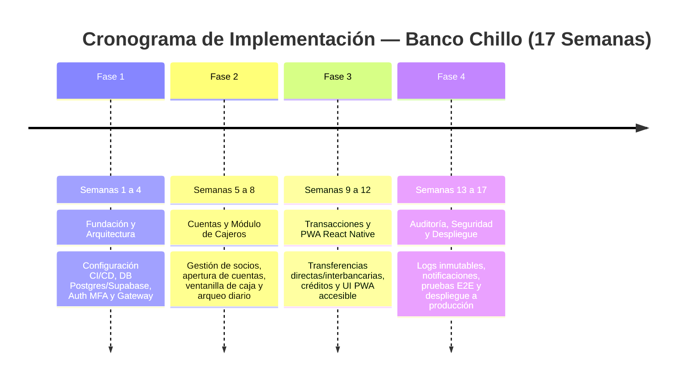

# Banco Chillo — Banca Web PWA y Plataforma de Microservicios

[](https://github.com/Odman-Arauz/banco_chillo/actions)
[](https://github.com/Odman-Arauz/banco_chillo/actions)
[](https://github.com/Odman-Arauz/banco_chillo/actions)

Plataforma bancaria modular orientada a **microservicios** con backend en **.NET**, frontend **PWA con React Native**, módulo operativo de **cajeros y personal administrativo**, y persistencia en **PostgreSQL / Supabase**.

---

## 🏛️ Componentes del Sistema

1. **Banca Web PWA (React Native / Expo Web)**:
   - Portal unificado responsive para clientes/socios (consulta de posición consolidada, transferencias directas e interbancarias, solicitudes de crédito).
   - Portal operativo para Personal Administrativo (ventanilla de cajeros, oficiales de crédito y supervisores).
   - Capacidades PWA: instalación en dispositivos móviles y de escritorio, soporte offline para consultas estáticas.
2. **Ecosistema de Microservicios (.NET 9/10 C# + Clean Architecture + CQRS)**:
   - `BancoChillo.Gateway`: Enrutador seguro con YARP, rate limiting y terminación TLS.
   - `BancoChillo.Auth`: Servicio de Identidad, OAuth2, JWT de corta duración y autenticación multifactor (MFA/OTP).
   - `BancoChillo.Cuentas`: Gestión de socios, cuentas de ahorro, cuentas corrientes e inversiones.
   - `BancoChillo.Cajeros`: Flujo completo de ventanilla (apertura de caja con fondo fijo, depósitos, retiros con validación, arqueo de billetes/monedas y cierre de jornada).
   - `BancoChillo.Transacciones`: Motor transaccional con idempotencia, débitos/créditos atómicos y transferencias interbancarias.
   - `BancoChillo.Creditos`: Simulador y gestión de préstamos (amortizaciones francesa y alemana).
   - `BancoChillo.Auditoria`: Trazabilidad inmutable de operaciones y eventos de cumplimiento financiero.
3. **Persistencia e Infraestructura**:
   - PostgreSQL 16+ con soporte para despliegue en **Supabase** y políticas de Row Level Security (RLS).
   - Redis para caché de sesión y control de concurrencia.
   - RabbitMQ para mensajería asíncrona y consistencia eventual mediante Outbox Pattern.

---

## 📅 Hoja de Ruta de 17 Semanas



| Fase | Semanas | Enfoque Principal | Entregables Clave |
|---|---|---|---|
| **Fase 1** | Semanas 1 - 4 | Fundación, Arquitectura y Auth | Esqueleto monorepo, CI/CD, base de datos PostgreSQL, IAM/Auth con MFA y Gateway YARP |
| **Fase 2** | Semanas 5 - 8 | Cuentas, Socios y Cajeros | Gestión de socios, cuentas de ahorro/corriente, apertura/cierre de cajas, depósitos, retiros y arqueo |
| **Fase 3** | Semanas 9 - 12 | Motor Transaccional y PWA | Transferencias internas y SPI, simulador de créditos, amortizaciones y Frontend PWA en React Native |
| **Fase 4** | Semanas 13 - 17 | Auditoría, Hardening y Despliegue | Microservicio de auditoría inmutable, notificaciones, pruebas de carga/seguridad y despliegue en Supabase/Cloud |

---

## 🚀 Inicio Rápido en Desarrollo Local

### Prerrequisitos
- .NET SDK 9.0 o 10.0+
- Node.js LTS (22+) y npm / pnpm
- Docker Desktop

### 1. Clonar el repositorio
```bash
git clone https://github.com/Odman-Arauz/banco_chillo.git
cd banco_chillo
git checkout develop
```

### 2. Levantar servicios de infraestructura (PostgreSQL, Redis, RabbitMQ)
```bash
docker compose up -d
```

### 3. Ejecutar compilación del backend
```bash
dotnet build
dotnet test
```

### 4. Iniciar Frontend PWA (React Native / Expo Web)
```bash
cd src/apps/pwa-banca
npm install
npm run web
```

---

## 📚 Estructura de Documentación

- [docs/adr/](docs/adr/): Decisiones de Arquitectura de Software.
- [docs/business-rules/](docs/business-rules/): Catálogo formal de Reglas de Negocio (RN-00X).
- [docs/specs/](docs/specs/): Especificaciones funcionales y planes de ejecución.
- [docs/security/](docs/security/): Políticas de seguridad financiera y protección de datos.
- [AGENTS.md](AGENTS.md): Reglas de operación para asistentes de IA y desarrollo guiado.
- [CONTRIBUTING.md](CONTRIBUTING.md): Guía de flujo de ramas y estándares de código.
- [SECURITY.md](SECURITY.md): Políticas de reporte de vulnerabilidades.
