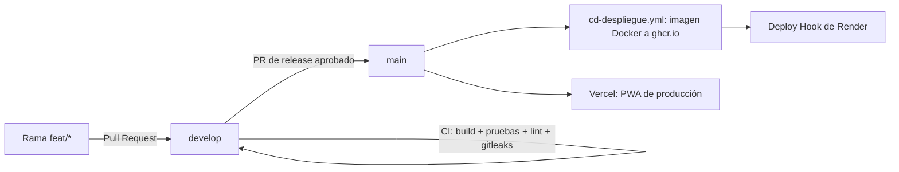

# ADR-0005: Estrategia de despliegue y CI/CD (Supabase + Render + Vercel + GHCR)

- **Estado:** Aceptado
- **Fecha:** 2026-11-22
- **Autores:** Docente / Tech Lead
- **Decisores:** Tech Lead

---

## 1. Contexto y Planteamiento del Problema

El proyecto es académico: los 7 estudiantes no tienen tarjeta de crédito ni presupuesto, pero la práctica exige
contenedores Docker y un pipeline de integración y entrega continua real y demostrable.

---

## 2. Opciones Consideradas

- **Opción 1 — Supabase + Render + Vercel + GitHub Container Registry:** todo con plan gratuito y sin tarjeta.
- **Opción 2 — Azure for Students:** Container Apps + Static Web Apps; más profesional, más configuración y crédito limitado.
- **Opción 3 — Railway / Fly.io:** rápido, pero el plan gratuito es muy limitado o pide tarjeta.

---

## 3. Decisión

Elegimos la **Opción 1**:

| Pieza | Plataforma | Cómo se despliega |
|---|---|---|
| PostgreSQL | **Supabase** (1 proyecto, un esquema por microservicio) | Workflow manual `db-supabase.yml` |
| Microservicios + Gateway | **Render** (Web Service con Docker, plan free) | `render.yaml` + Deploy Hooks desde `cd-despliegue.yml` |
| Imágenes Docker | **GitHub Container Registry** (`ghcr.io`) | `cd-despliegue.yml` al llegar a `main` |
| PWA | **Vercel** (raíz `src/apps/pwa-banca`) | Integración Git de Vercel (vista previa por PR) |
| App de escritorio `.exe` | **GitHub Releases** | `cd-escritorio.yml` al crear el tag `escritorio-v*` |
| Redis / RabbitMQ (fases 3–4) | Upstash / CloudAMQP (planes gratuitos) | Variables de entorno |

### Flujo de entrega

---

## 4. Consecuencias

### Positivas
- Costo cero, sin tarjeta. Cada paso del pipeline se puede mostrar en el informe (capturas de GitHub Actions, Render y Vercel).
- Las mismas imágenes Docker corren en local (`docker compose --profile apps up`) y en Render.

### Negativas / Trade-offs
- Render free "duerme" los servicios tras 15 minutos sin tráfico (la primera petición tarda unos 50 s) y da
  750 horas al mes por cuenta. Mitigación: desplegar solo los servicios terminados; si hace falta, cada
  estudiante despliega su microservicio en su propia cuenta de Render y se actualiza la URL en el Gateway.
- La conexión directa de Supabase usa IPv6; desde Render se usa el **Session Pooler** (IPv4, puerto 5432).
- Supabase free pausa el proyecto tras 7 días sin actividad: reanudarlo desde el panel antes de una demo.
