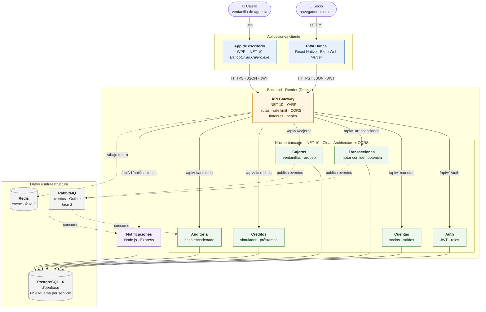
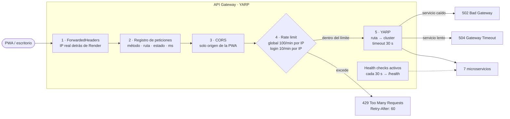
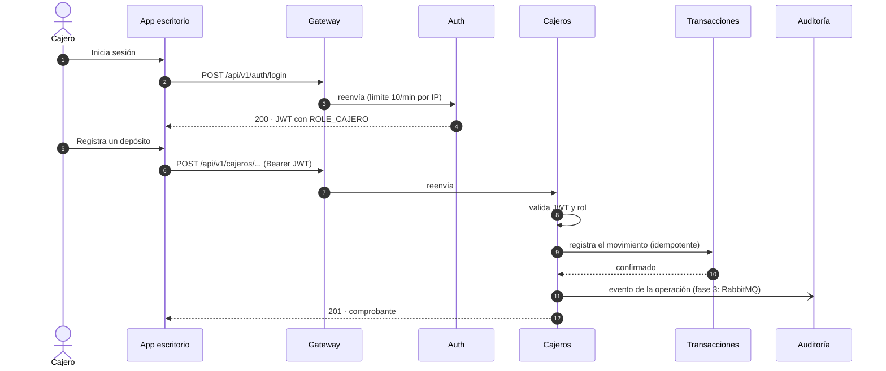
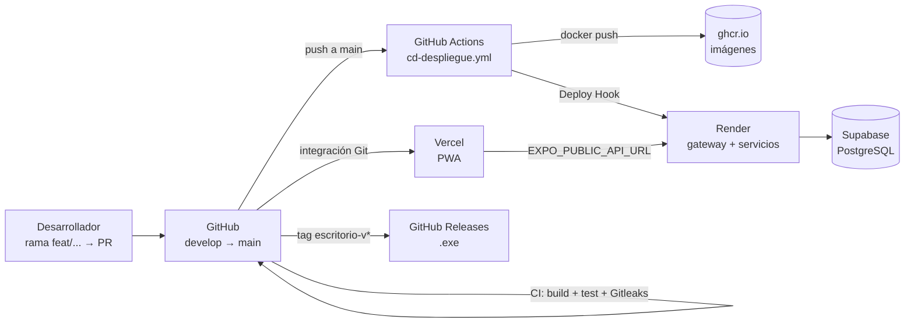

# Arquitectura de Banco Chillo

- **Responsable:** @Ronaldtipan (Issue #30, entregable 3)
- **Nivel:** C4 nivel 2 (contenedores), dibujado en Mermaid
- **Decisiones de referencia:** ADR-0001, ADR-0004, ADR-0005, ADR-0006, ADR-0007 y spec-0002 (gateway)
- **Fecha:** 2026-11-25

GitHub dibuja los diagramas Mermaid automáticamente al abrir este archivo.

---

## 1. Contenedores (C4 nivel 2)

**Lectura rápida**

- Los clientes (PWA y escritorio) **solo** conocen la URL del gateway. Ningún microservicio se expone directo (spec-0002, RG-01).
- El gateway **no** valida el JWT: lo reenvía y cada microservicio lo valida (defensa en profundidad).
- Siete microservicios: seis en .NET y uno en Node.js (ADR-0004), todos con el mismo JWT emitido por Auth.
- Una sola base PostgreSQL en Supabase con **un esquema por servicio** y sin consultas entre esquemas (ADR-0007).
- Líneas punteadas = piezas planificadas para la fase 3 (Redis y RabbitMQ con Outbox); hoy existen en Docker pero aún no se usan.

---

## 2. Responsabilidades de cada contenedor

| Contenedor | Tecnología | Puerto local | Esquema BD | Responsabilidad | Responsable S5 |
|---|---|---|---|---|---|
| PWA Banca | React Native · Expo Web | 8081 | — | Interfaz del socio y navegación por rol | S0yRai |
| App de escritorio | WPF · .NET 10 | — | — | Operación de ventanilla del cajero | — |
| API Gateway | .NET 10 · YARP | 5000 | — | Punto único de entrada, rate limit, CORS, timeouts, salud | Ronald |
| Auth | .NET 10 | 5001 | `auth_bc` | Registro, login, emisión de JWT, roles | Odman |
| Cajeros | .NET 10 | 5002 | `cajeros_bc` | Agencias, ventanillas, apertura, operaciones, arqueo y cierre | Jostin · Josué · Mateo |
| Cuentas | .NET 10 | 5003 | `cuentas_bc` | Socios, cuentas y saldos | Mathias |
| Transacciones | .NET 10 | 5004 | `transacciones_bc` | Depósitos, retiros y transferencias con idempotencia | Mathias |
| Créditos | .NET 10 | 5005 | `creditos_bc` | Simulación y gestión de préstamos | Jostin |
| Auditoría | .NET 10 | 5006 | `auditoria_bc` | Registro inmutable con hash encadenado | Josué |
| Notificaciones | Node.js · Express | 5007 | `notificaciones_bc` | Plantillas, preferencias y envíos (correo/SMS/push simulados) | Mateo |

---

## 3. Detalle del API Gateway (spec-0002)

Endpoints propios del gateway: `GET /health` (lo usa Render), `GET /health/servicios` (estado de los 7 servicios, 3 s máximo por servicio) y `GET /` (lista de rutas).

---

## 4. Flujo de una operación de ventanilla (ejemplo)

---

## 5. Despliegue (ADR-0005)

| Pieza | Plataforma | Cómo llega |
|---|---|---|
| Gateway y microservicios | Render (Docker, plan free) | `render.yaml` + Deploy Hooks desde `cd-despliegue.yml` |
| Imágenes Docker | GitHub Container Registry | `cd-despliegue.yml` al llegar a `main` |
| Base de datos | Supabase | Workflow manual `db-supabase.yml` |
| PWA | Vercel | Integración Git (vista previa por PR) |
| App de escritorio | GitHub Releases | `cd-escritorio.yml` con el tag `escritorio-v*` |

En local todo corre con `docker compose --profile apps up -d --build` (gateway + 7 servicios + PostgreSQL, Redis y RabbitMQ).
