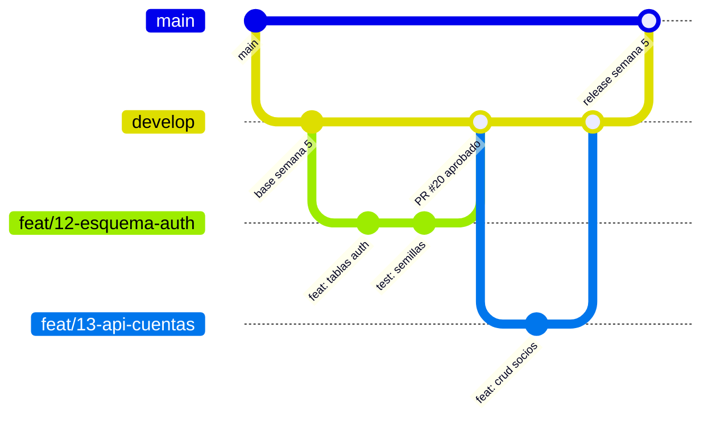

# 05 · Flujo Git: ramas, commits y Pull Requests



## Reglas

1. **Nunca** se trabaja ni se hace push en `main` ni en `develop` (están protegidas; el push falla).
2. **Una rama por Issue**, creada desde `develop` actualizado.
3. Nombre de rama: `tipo/<numero-issue>-<descripcion-corta>` en minúsculas y con guiones.
   - `feat/12-esquema-auth-usuarios` · `fix/18-redondeo-amortizacion` · `docs/21-guia-errores` · `chore/22-dockerfile-cuentas`
4. Commits pequeños y frecuentes (mínimo uno por día de trabajo) con **Conventional Commits en español**.
5. Todo entra a `develop` por **Pull Request** con CI en verde y **1 aprobación** de un compañero.
6. `develop` → `main` solo al cierre de semana, por PR del Tech Lead/docente.

## Ciclo completo paso a paso

```powershell
# 1. Ponerte al día
git checkout develop
git pull origin develop

# 2. Crear tu rama (opción A: manual)
git checkout -b feat/12-esquema-auth-usuarios
#    (opción B: ligada al Issue en GitHub, recomendado)
gh issue develop 12 --base develop --name feat/12-esquema-auth-usuarios --checkout

# 3. Trabajar... luego revisar qué cambiaste
git status
git diff

# 4. Agregar y confirmar (commit)
git add database/schema/01-auth/
git commit -m "feat(auth): agregar tablas refresh_tokens e intentos_login"

# 5. Subir tu rama (la primera vez con -u)
git push -u origin feat/12-esquema-auth-usuarios

# 6. Mantener tu rama al día con develop (hazlo a diario)
git fetch origin
git merge origin/develop          # resuelve conflictos si aparecen, luego git push

# 7. Antes del PR: correr pruebas
dotnet build; dotnet test         # o npm test / npm run lint

# 8. Abrir el Pull Request
gh pr create --base develop --title "feat(auth): esquema de usuarios, roles y tokens" --body "Closes #12"

# 9. Revisar la CI y los comentarios
gh pr checks
gh pr view --web
```

Después de que te aprueben y se fusione (*Squash and merge*):

```powershell
git checkout develop
git pull origin develop
git branch -d feat/12-esquema-auth-usuarios
```

## Conventional Commits

Formato: `tipo(alcance opcional): descripción en minúsculas, imperativo, sin punto final`

| Tipo | Úsalo cuando… | Ejemplo |
|---|---|---|
| `feat` | Agregas funcionalidad | `feat(cajeros): agregar crud de ventanillas` |
| `fix` | Corriges un error | `fix(creditos): corregir redondeo de cuota francesa` |
| `test` | Solo pruebas | `test(cuentas): agregar pruebas de validador de socio` |
| `docs` | Documentación, ADR, spec | `docs(adr): agregar adr-0008 de idempotencia` |
| `refactor` | Cambias código sin cambiar comportamiento | `refactor(auth): extraer servicio de hash` |
| `chore` | Configuración, dependencias, Docker, CI | `chore(gateway): agregar ruta de auditoria` |
| `style` | Formato (espacios, comas) | `style(pwa): aplicar prettier` |

❌ Mal: `cambios`, `avance`, `ya funciona`, `fix`, `subo lo de ayer`, `Update Program.cs`
✅ Bien: `feat(cuentas): agregar endpoint get /api/v1/socios/{id}`

Para cerrar un Issue automáticamente, en la descripción del PR escribe `Closes #12`.

## Revisión de código (cuando te toca revisar el PR de un compañero)

```powershell
gh pr list
gh pr checkout 25        # bajar la rama del PR y probarla en tu máquina
gh pr review 25 --approve --body "Probado en local, funciona"
gh pr review 25 --request-changes --body "Falta el validador del campo telefono"
```

Checklist mínimo del revisor:
- [ ] ¿Compila y pasan las pruebas en mi máquina?
- [ ] ¿Sigue la estructura del ejemplo de referencia?
- [ ] ¿Hay datos reales o secretos? (cédulas, correos, contraseñas reales → rechazar)
- [ ] ¿El SQL es idempotente y los montos son `NUMERIC(14,2)`?
- [ ] ¿El PR hace **solo** lo que dice el Issue?

## Qué NO se sube nunca

- `.env`, `appsettings.Production.json`, llaves, tokens, contraseñas reales.
- `bin/`, `obj/`, `node_modules/`, `dist/`, `publicacion/` (ya están en `.gitignore`).
- Datos personales reales (regla de oro 1 de `AGENTS.md`).
