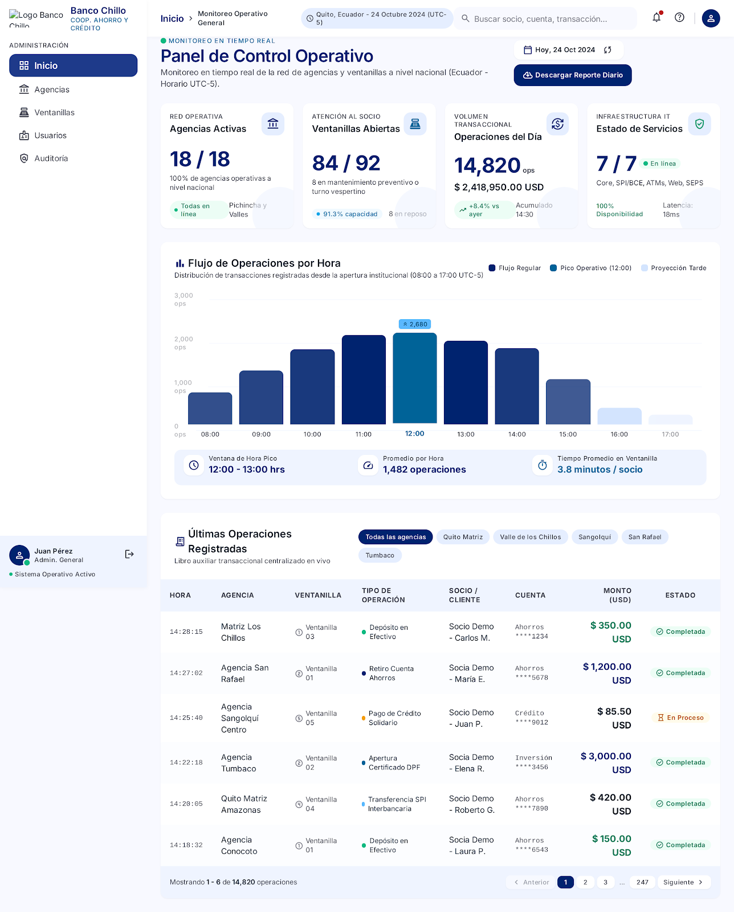
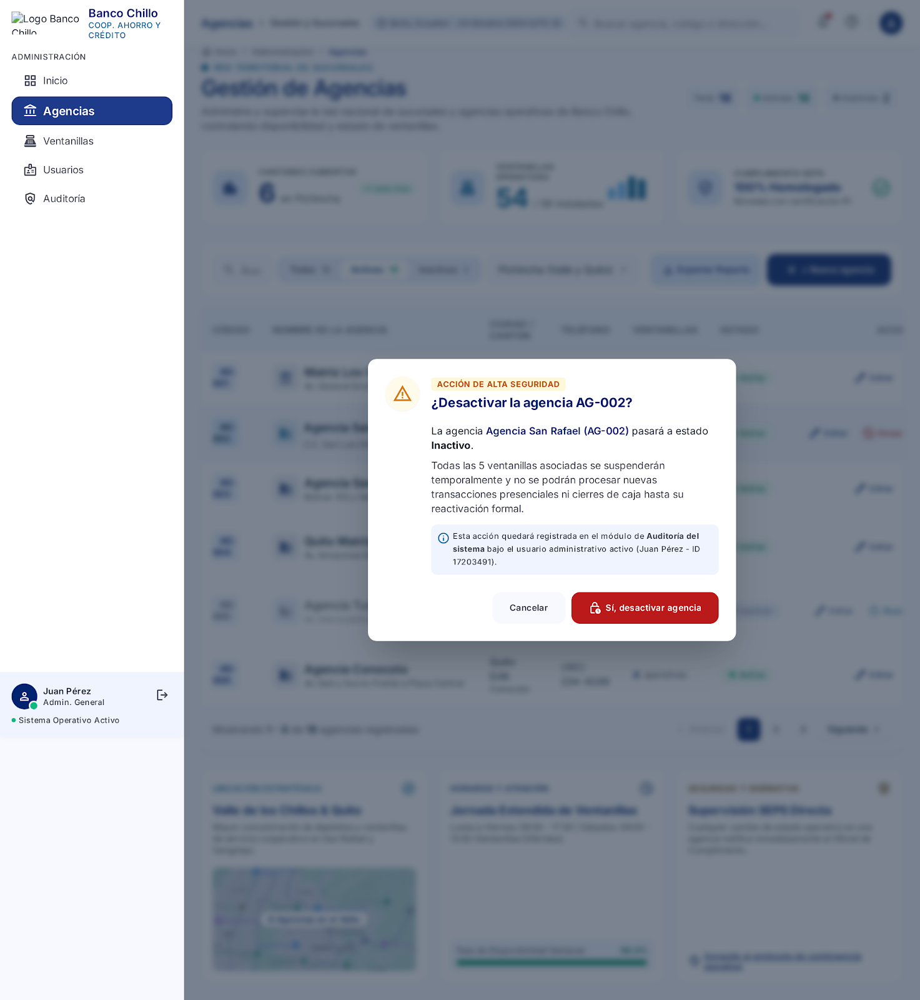
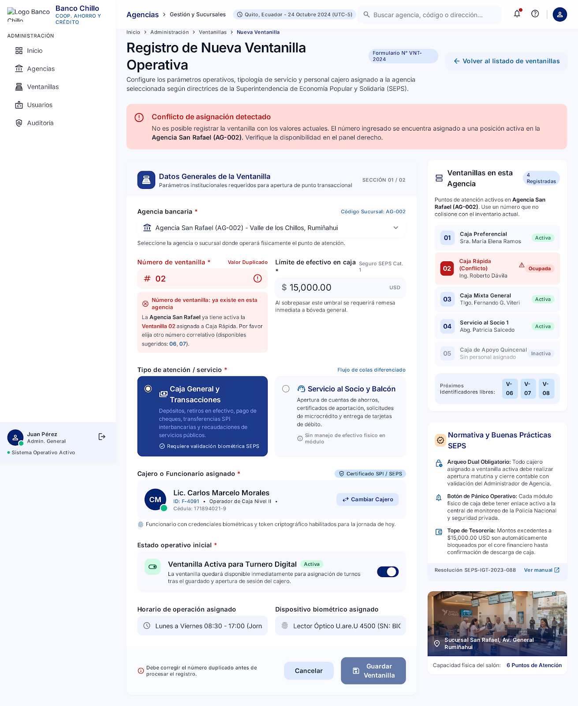

# Mockups · Administración

- **Módulo:** Administración (dashboard, CRUD de agencias y ventanillas)
- **Responsable:** @Ronaldtipan (Gateway / DevOps)
- **Herramienta:** Google Stitch, diseño **Web** (escritorio 1440 px)
- **Guía:** [08 · Mockups con Google Stitch](../../guias/08-mockups-google-stitch.md)
- **Identidad visual:** primario `#1E3A8A`, secundario `#0284C7`, acento `#F59E0B`, éxito `#10B981`, error `#EF4444`, fondo `#F8FAFC`; tipografía Inter; bordes de 12 px.

| # | Pantalla | Archivo |
|---|---|---|
| 1 | Dashboard del administrador | [01-dashboard.png](01-dashboard.png) |
| 2 | Gestión de agencias (lista, filtros y desactivar) | [02-agencias.png](02-agencias.png) |
| 3 | Formulario de nueva ventanilla con error de validación | [03-ventanilla.png](03-ventanilla.png) |

## 1. Dashboard



Prompt usado:

```text
Diseña una pantalla para "Banco Chillo", una cooperativa de ahorro y crédito ecuatoriana.
Estilo: moderno, limpio, confiable, alto contraste (WCAG AA), en español, moneda USD.
Colores: primario #1E3A8A, secundario #0284C7, acento #F59E0B, éxito #10B981, error #EF4444, fondo #F8FAFC.
Tipografía Inter, bordes redondeados de 12 px, iconos lineales.
Usa solo datos ficticios evidentes (ej. "Socio Demo", cuenta ****1234).
Pantalla: Dashboard del administrador, escritorio 1440 px. Menú lateral: Inicio, Agencias, Ventanillas, Usuarios, Auditoría. Arriba 4 tarjetas: agencias activas, ventanillas abiertas hoy, operaciones del día, estado de los servicios (7 de 7 en línea, verde). Abajo una tabla de últimas operaciones por agencia y un gráfico de barras de operaciones por hora.
```

La tarjeta "estado de los servicios" se alimenta de `GET /health/servicios` del gateway (Issue #18).

## 2. Gestión de agencias



Prompt usado (misma conversación de Stitch):

```text
Pantalla: Gestión de agencias, misma identidad visual y menú lateral. Buscador, filtro Activas/Inactivas y botón primario "Nueva agencia". Tabla con Código (AG-001), Nombre, Ciudad, Teléfono, Estado (etiqueta verde Activa / gris Inactiva) y acciones Editar y Desactivar. Incluye el diálogo de confirmación "¿Desactivar la agencia AG-002?".
```

Endpoints relacionados: `GET/POST/PUT/DELETE /api/v1/cajeros/agencias` (la baja es lógica).

## 3. Nueva ventanilla



Prompt usado (misma conversación de Stitch):

```text
Pantalla: Formulario "Nueva ventanilla", misma identidad visual. Campos: Agencia (lista desplegable), Número de ventanilla, Tipo (Caja / Servicio al cliente), Cajero asignado, Estado. Muestra un error de validación en "Número de ventanilla: ya existe en esta agencia". Botones "Guardar" y "Cancelar".
```

Endpoint relacionado: CRUD de ventanillas del Issue #21 (Jostin). El error de duplicado corresponde a la respuesta `409`.
