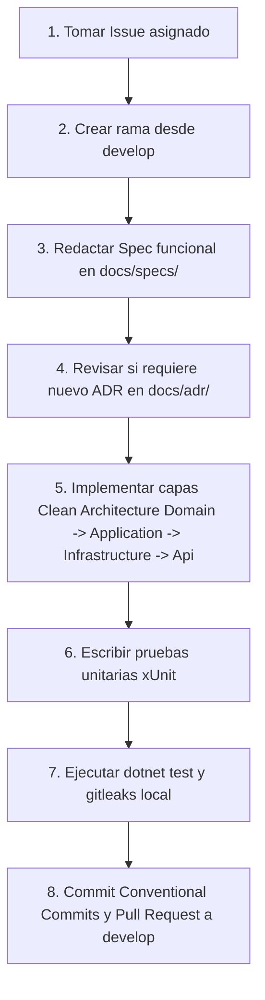

# 📘 Guía Paso a Paso para Desarrolladores — Banco Chillo

Bienvenido al equipo de desarrollo de **Banco Chillo**. Esta guía está diseñada para que conozcas exactamente el flujo de trabajo antes de escribir la primera línea de código y asegurar la calidad financiera del proyecto.

---

## 🧭 Flujo de Trabajo Obligatorio (Paso a Paso)



---

## 1. Crear tu rama de trabajo
**NUNCA trabajes directamente en `main` ni en `develop`.**
```bash
git checkout develop
git pull origin develop
git checkout -b feat/<numero-issue>-<descripcion-corta>
# Ejemplo: git checkout -b feat/3-apertura-caja
```

---

## 2. Documentar la Especificación (`docs/specs/`)
Antes de codificar, crea una carpeta para tu funcionalidad duplicando `docs/specs/_plantilla/`:
```bash
# Ejemplo para el Issue #3
docs/specs/spec-0003-apertura-caja/
├── spec.md      # Describe qué hace la función y casos de prueba Gherkin
├── plan.md      # Detalla qué archivos y capas vas a tocar
└── tasks.md     # Lista de checkboxes con tus tareas técnicas
```
*Si tienes dudas del diseño funcional, consulta con el Tech Lead antes de continuar.*

---

## 3. ¿Necesitas un ADR (Architectural Decision Record)?
- Revisa los ADRs existentes en `docs/adr/`.
- Si tu tarea sigue los patrones ya aprobados (Clean Architecture, CQRS, MediatR, EF Core), **NO** necesitas crear un nuevo ADR; solo referencia los existentes en tu spec.
- Si vas a introducir una librería nueva, cambiar un motor de base de datos o modificar la forma en que se comunican los servicios, debes crear un ADR usando `docs/adr/ADR-0000-plantilla.md`.

---

## 4. Orden de Implementación (Clean Architecture)

### Paso 1: `Domain` (El corazón del negocio)
- **Ruta:** `src/services/<modulo>/BancoChillo.<Modulo>.Domain/`
- **Qué va aquí:** Entidades (ej. `SesionCaja.cs`), Value Objects (ej. `MontoDinero.cs`), Enumeraciones (ej. `EstadoCaja.cs`), Interfaces de Repositorios (ej. `ISesionCajaRepository.cs`), Excepciones de Dominio.
- ⚠️ **REGLA DE ORO:** Esta capa **NO** debe tener dependencias de Entity Framework, SQL, librerías web ni controladores. Es C# puro.

### Paso 2: `Application` (Casos de Uso)
- **Ruta:** `src/services/<modulo>/BancoChillo.<Modulo>.Application/`
- **Qué va aquí:**
  - **Commands:** Operaciones que modifican datos (ej. `AbrirCajaCommand.cs`, `AbrirCajaCommandHandler.cs`).
  - **Queries:** Consultas de solo lectura (ej. `ObtenerEstadoCajaQuery.cs`).
  - **Validaciones:** Reglas de entrada con `FluentValidation` (ej. `AbrirCajaCommandValidator.cs`).
  - **DTOs:** Objetos de transferencia de datos para la API.

### Paso 3: `Infrastructure` (Persistencia y Adaptadores)
- **Ruta:** `src/services/<modulo>/BancoChillo.<Modulo>.Infrastructure/`
- **Qué va aquí:** Mapeos de Entity Framework Core (`EntityTypeConfiguration`), implementaciones de repositorios, DbContext, migraciones y llamadas a servicios externos.

### Paso 4: `Api` (Controladores y Swagger)
- **Ruta:** `src/services/<modulo>/BancoChillo.<Modulo>.Api/`
- **Qué va aquí:** Controladores HTTP (`Controllers/`) o Minimal APIs que reciben las peticiones, validan el token JWT y despachan el Command/Query a MediatR.

---

## 5. Pruebas Unitarias
- Escribe pruebas unitarias para cada Command Handler y entidad de dominio en la carpeta `tests/`.
- Usa `xUnit` y `FluentAssertions`.
- Ejecuta las pruebas localmente:
  ```bash
  dotnet test
  ```

---

## 6. Commits y Pull Request
Realiza commits claros bajo **Conventional Commits**:
```bash
git add .
git commit -m "feat: implementar apertura de caja con validacion de fondo inicial"
git push origin feat/3-apertura-caja
```
Abre tu Pull Request en GitHub apuntando a **`develop`** e incluye en la descripción:
```markdown
Closes #3
```
Esto vinculará y cerrará automáticamente el issue al completarse la revisión.

---

## ⚠️ Reglas Críticas que NUNCA debes romper

1. **PROHIBIDO USAR DATOS REALES**: Ninguna cédula ecuatoriana real, nombre real ni clave real. Usa datos sintéticos.
2. **CERO SECRETOS**: Nunca subas passwords, API keys ni tokens al código. Usa variables de entorno (`.env`).
3. **INMUTABILIDAD FINANCIERA**: En transacciones y arqueos de caja nunca uses `DELETE` ni modifiques montos pasados. Todo ajuste se hace mediante transacciones de reverso auditadas.
