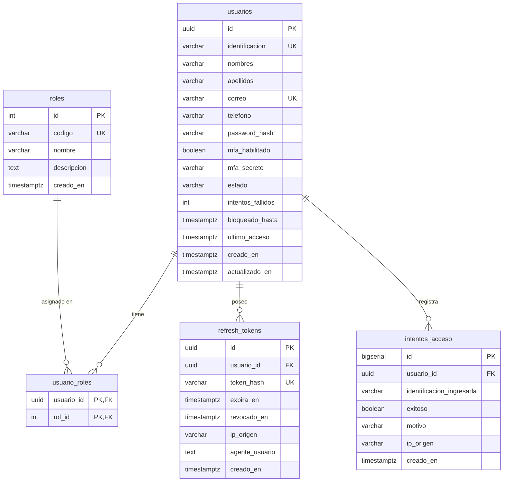

# Plan de Implementación: Esquema auth_bc, Inmutabilidad, RLS y Semillas

- **Especificación:** SPEC-0001 (Autenticación y Control de Acceso)
- **Issue:** #16
- **Servicio:** `src/services/auth/`
- **Base de Datos:** PostgreSQL 16 / Supabase (`auth_bc`)

---

## 1. Diagrama Entidad-Relación (Mermaid)

---

## 2. Lista de Tablas del Módulo

| Tabla | Propósito | Características Especiales |
|---|---|---|
| `auth_bc.roles` | Catálogo de roles de la plataforma bancaria | Identificador secuencial, código único |
| `auth_bc.usuarios` | Identidades, credenciales y estado de clientes/empleados | Identificación única, `CHECK (estado IN ('ACTIVO', 'BLOQUEADO', 'INACTIVO'))`, `bloqueado_hasta` |
| `auth_bc.usuario_roles` | Relación N:M entre cuentas y roles asignados | Clave primaria compuesta, eliminación en cascada |
| `auth_bc.refresh_tokens` | Sesiones extendidas persistentes con rotación | `token_hash` SHA-256 único (nunca texto plano), revocación e IP |
| `auth_bc.intentos_acceso` | Bitácora de accesos y auditoría de seguridad | Append-only mediante trigger `trg_intentos_acceso_inmutables`, índice descendente por fecha |

---

## 3. Justificación de Row Level Security (RLS) sin Políticas

> [!NOTE] Justificación Técnica de RLS (3 líneas requeridas por Issue #16):
> En Supabase, activar RLS sin definir políticas deniega por defecto todo acceso externo a través de la API REST pública (PostgREST / Data API).
> Dado que la configuración del proyecto expone únicamente el esquema `public` y nuestros microservicios se conectan mediante conexión directa (PostgreSQL / Npgsql) con el usuario autenticado de la base de datos, este mecanismo garantiza blindaje perimetral total sin sobrecarga de evaluación de políticas en la base de datos.

---

## 4. Decisiones Técnicas y Criptografía

1. **Hash de Contraseñas:** 
   - Se utiliza el algoritmo **BCrypt** con factor de costo 12 (`$2a$12$...`).
   - La contraseña unificada de desarrollo y prueba es `Demo#2026`.
   - Se generó y verificó criptográficamente mediante la librería estándar `bcrypt`:
     - Resumen: `$2a$12$8IFwAuRD1z4tChTG5lzowugGet7uxQntd9mbVJW/4CYTzOzadEe8S`
2. **Cédulas Ecuatorianas de Prueba (Módulo 10):**
   - Se generaron 7 números de cédula utilizando el código de provincia de prueba `30` (permitido por convención bancaria y ADR-0007 para pruebas sin colisión con personas naturales reales) cumpliendo estrictamente el algoritmo de validación módulo 10.
3. **Inmutabilidad Append-Only:**
   - La tabla `auth_bc.intentos_acceso` cuenta con una función y trigger `trg_intentos_acceso_inmutables` que lanza una excepción `PL/pgSQL` ante cualquier instrucción `UPDATE` o `DELETE`.

---

## 5. Estrategia de Pruebas

- **Prueba de inicialización:** Ejecución en contenedor limpio (`docker compose down -v && docker compose up -d`) verificando orden de scripts (`01-auth-schema.sql` → `02-auth-rls.sql` → `01-catalogos-financieros.sql` → `02-auth-usuarios-demo.sql`).
- **Prueba de rechazo de mutación:** Intento explícito de `DELETE FROM auth_bc.intentos_acceso;` debe fallar con error de tabla inmutable.
- **Prueba de idempotencia:** Segunda ejecución consecutiva de todos los scripts sin errores ni duplicados.
- **Compilación de la solución:** `dotnet build` y `dotnet test` deben pasar al 100%.
