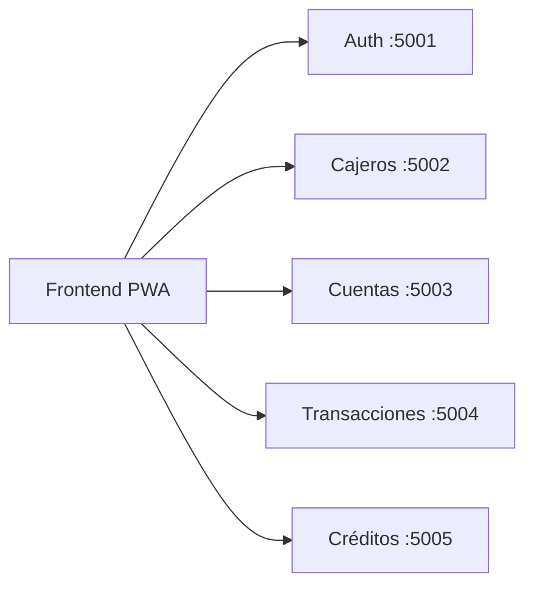
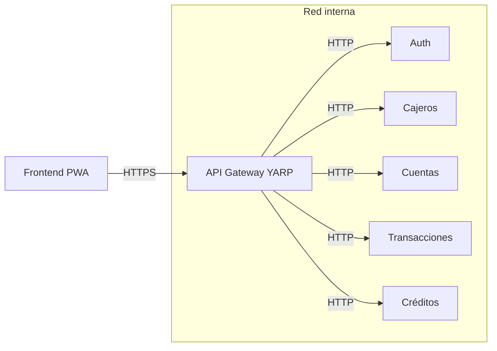
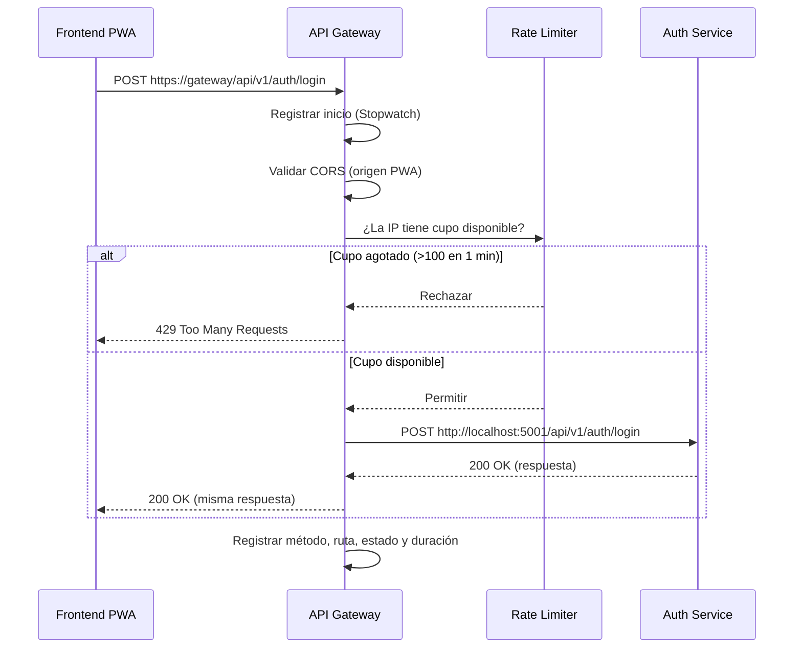

# Especificación: API Gateway Centralizado con YARP y Políticas de Resiliencia

- **ID:** SPEC-0002
- **Módulo:** Gateway (`src/gateway/BancoChillo.Gateway`)
- **Estado:** Implementada (Issue #18)
- **Fecha:** 2026-11-12 (ampliada 2026-11-14, decisiones cerradas 2026-11-25)
- **Issue:** #2
- **ADR de referencia:** [ADR-0001 — Arquitectura de Microservicios con Clean Architecture y CQRS](../../adr/ADR-0001-arquitectura-microservicios-clean-cqrs.md)
- **Documentos relacionados:** [`plan.md`](./plan.md), [`tasks.md`](./tasks.md), [`AGENTS.md`](../../../AGENTS.md), [Guía de desarrollo para juniors](../../procedimientos/guia-desarrollo-juniors.md)

---

## Índice

1. [Propósito y Alcance](#1-propósito-y-alcance)
2. [Contexto y Problema Actual](#2-contexto-y-problema-actual)
3. [Glosario](#3-glosario)
4. [Historias de Usuario Asociadas](#4-historias-de-usuario-asociadas)
5. [Reglas de Negocio Aplicables](#5-reglas-de-negocio-aplicables)
6. [Requisitos Funcionales](#6-requisitos-funcionales)
7. [Requisitos No Funcionales](#7-requisitos-no-funcionales)
8. [Criterios de Aceptación (Gherkin)](#8-criterios-de-aceptación-gherkin)
9. [Diseño Técnico y Endpoints](#9-diseño-técnico-y-endpoints)
10. [Consideraciones de Seguridad](#10-consideraciones-de-seguridad)
11. [Manejo de Errores](#11-manejo-de-errores)
12. [Observabilidad](#12-observabilidad)
13. [Riesgos y Mitigaciones](#13-riesgos-y-mitigaciones)
14. [Decisiones Pendientes / Preguntas para el Tech Lead](#14-decisiones-pendientes--preguntas-para-el-tech-lead)
15. [ADR](#15-adr)
16. [Definición de Terminado (DoD)](#16-definición-de-terminado-dod)
17. [Referencias](#17-referencias)

---

## 1. Propósito y Alcance

Banco Chillo expone varios microservicios internos (Auth, Cajeros, Cuentas, Transacciones y Créditos), cada uno en su propio puerto. El frontend PWA no debe conocer ni conectarse directamente a esos servicios.

Esta especificación define un **API Gateway** como **punto único de entrada seguro** que:

1. Encamina el tráfico del frontend PWA hacia el microservicio correspondiente según la ruta (`/api/v1/<modulo>/...`), sin exponer puertos ni direcciones internas.
2. Aplica **limitación de velocidad (rate limiting)**: máximo 100 peticiones por minuto por dirección IP, para mitigar ataques de fuerza bruta y abuso.
3. Aplica **tiempos de espera (timeouts)** hacia los servicios internos para que un servicio lento no bloquee al Gateway.
4. Realiza la **terminación TLS**: el tráfico externo llega por HTTPS y el Gateway lo descifra antes de reenviarlo a la red interna.
5. Restringe **CORS** para aceptar únicamente el origen del frontend PWA.
6. Registra cada petición con su **tiempo de respuesta** para observabilidad.

### 1.1 Dentro del alcance
- Configuración de YARP (rutas y clusters) en `appsettings.json`.
- Middlewares de rate limiting, CORS, HTTPS y registro de peticiones en `Program.cs`.
- Política de timeout por cluster.
- Pruebas de integración del Gateway (reenvío, 429, 404).

### 1.2 Fuera del alcance
- Autenticación/validación de JWT en el Gateway (se abordará en una especificación posterior junto al servicio de Auth).
- Rate limiting distribuido con Redis (ver sección 14, decisiones pendientes).
- Balanceo de carga entre múltiples instancias de un mismo servicio.
- Exposición del servicio de Auditoría (es interno y no lo consume la PWA).
- Cambios en el frontend PWA (solo deberá apuntar su URL base al Gateway en una tarea posterior).
- Despliegue en contenedores / nube (se documentará en una especificación de infraestructura).

---

## 2. Contexto y Problema Actual

Actualmente el proyecto `BancoChillo.Gateway` existe pero solo contiene un endpoint de ejemplo (`MapGet("/", () => "Hello World!")`). Cada microservicio se ejecuta en un puerto diferente, por lo que, sin Gateway, el frontend tendría que:

- Conocer y mantener la dirección de **cada** microservicio (cinco URLs distintas).
- Configurar CORS, HTTPS y límites de peticiones en **cada** servicio por separado, duplicando código y aumentando el riesgo de olvidar alguna protección.
- Exponer a Internet todos los puertos internos, aumentando la superficie de ataque.

### 2.1 Arquitectura sin Gateway (situación a evitar)



### 2.2 Arquitectura con Gateway (situación objetivo)



Con el Gateway, el frontend conoce **una sola URL**, y las políticas de seguridad transversales (CORS, HTTPS, rate limiting, timeouts, logs) se aplican **en un solo lugar**.

---

## 3. Glosario

| Término | Definición |
|---------|------------|
| **API Gateway** | Componente que actúa como punto único de entrada para todas las peticiones de los clientes y las reenvía al servicio interno adecuado. |
| **Reverse proxy (proxy inverso)** | Servidor intermediario que recibe peticiones en nombre de otros servidores y las reenvía, ocultando su ubicación real. |
| **YARP** | *Yet Another Reverse Proxy*: librería de Microsoft para construir reverse proxies en .NET. |
| **Ruta (Route)** | Regla de YARP que indica qué URLs entrantes debe atender (por ejemplo, `/api/v1/auth/{**catch-all}`). |
| **Cluster** | Grupo de destinos (direcciones de servicios) a los que YARP reenvía las peticiones de una ruta. |
| **Destino (Destination)** | Dirección concreta de una instancia de un microservicio (por ejemplo, `http://localhost:5001`). |
| **Rate limiting** | Técnica que limita la cantidad de peticiones que un cliente puede hacer en un periodo de tiempo. |
| **Ventana fija (Fixed Window)** | Algoritmo de rate limiting que cuenta peticiones en bloques de tiempo fijos (por ejemplo, cada minuto). |
| **CORS** | *Cross-Origin Resource Sharing*: mecanismo del navegador que controla qué sitios web pueden llamar a una API. |
| **TLS / HTTPS** | Protocolo de cifrado del tráfico. La *terminación TLS* significa que el Gateway descifra el tráfico HTTPS entrante. |
| **Timeout** | Tiempo máximo de espera por la respuesta de un servicio antes de cancelar la petición. |
| **Resiliencia** | Capacidad del sistema de seguir funcionando ante fallos parciales (servicios lentos o caídos). |
| **Polly** | Librería .NET de resiliencia (reintentos, circuit breaker, timeouts). Se usa a través de `Microsoft.Extensions.Http.Resilience`. |
| **Observabilidad** | Capacidad de entender el comportamiento del sistema a partir de sus registros (logs), métricas y trazas. |
| **PWA** | *Progressive Web App*: el frontend web de Banco Chillo (ver ADR-0002). |

---

## 4. Historias de Usuario Asociadas

- **US-01:** Como sistema bancario, quiero un punto único de entrada seguro (API Gateway) para encaminar el tráfico del frontend PWA hacia los microservicios internos, aplicando políticas de limitación de velocidad, tiempo de espera y terminación TLS.
- **US-02 (derivada):** Como equipo de seguridad, quiero que un cliente que realice demasiadas peticiones sea bloqueado temporalmente, para reducir el riesgo de ataques de fuerza bruta contra el login.
- **US-03 (derivada):** Como equipo de operaciones, quiero ver en los registros cada petición con su tiempo de respuesta, para detectar servicios lentos o con errores.
- **US-04 (derivada):** Como desarrollador frontend, quiero una sola URL base para todas las APIs, para no tener que configurar la dirección de cada microservicio.

---

## 5. Reglas de Negocio Aplicables

- **RG-01 — Punto único de entrada:** el frontend PWA solo se comunica con el Gateway. Ningún microservicio interno se expone directamente al cliente.
- **RG-02 — Límite de peticiones:** cada dirección IP puede realizar como máximo **100 peticiones en una ventana de 1 minuto**. Al superarlo, el Gateway responde `429 Too Many Requests` sin reenviar la petición.
- **RG-03 — Origen permitido:** solo el origen configurado del frontend PWA puede realizar peticiones desde navegador (CORS).
- **RG-04 — Cero secretos:** las URLs, orígenes y límites se leen de configuración / variables de entorno; no se incluyen credenciales en el repositorio (regla de oro N.º 2 de `AGENTS.md`).
- **RG-05 — Sin datos reales en logs:** los registros del Gateway no deben incluir cuerpos de petición, contraseñas, tokens, cédulas ni números de cuenta; solo método, ruta, código de estado y tiempo de respuesta (regla de oro N.º 1 de `AGENTS.md`).
- **RG-06 — Transparencia:** el Gateway no modifica el contenido de las peticiones ni de las respuestas; solo las reenvía.

---

## 6. Requisitos Funcionales

| ID | Requisito | Prioridad |
|----|-----------|-----------|
| **RF-01** | El Gateway debe reenviar las peticiones `/api/v1/auth/**` al servicio de Auth. | Alta |
| **RF-02** | El Gateway debe reenviar las peticiones `/api/v1/cajeros/**` al servicio de Cajeros. | Alta |
| **RF-03** | El Gateway debe reenviar las peticiones `/api/v1/cuentas/**` al servicio de Cuentas. | Alta |
| **RF-04** | El Gateway debe reenviar las peticiones `/api/v1/transacciones/**` al servicio de Transacciones. | Alta |
| **RF-05** | El Gateway debe reenviar las peticiones `/api/v1/creditos/**` al servicio de Créditos. | Alta |
| **RF-06** | El Gateway debe responder `404 Not Found` a rutas que no estén registradas. | Media |
| **RF-07** | El Gateway debe rechazar con `429` las peticiones de una IP que supere 100 peticiones/minuto. | Alta |
| **RF-08** | El Gateway debe permitir CORS únicamente para el origen configurado de la PWA. | Alta |
| **RF-09** | El Gateway debe redirigir el tráfico HTTP a HTTPS. | Alta |
| **RF-10** | El Gateway debe cancelar las peticiones a servicios que no respondan dentro del timeout (30 s). | Media |
| **RF-11** | El Gateway debe registrar método, ruta, código de estado y duración de cada petición. | Media |
| **RF-12** | Las rutas, destinos, origen CORS y timeouts deben poder cambiarse por configuración, sin recompilar. | Media |

---

## 7. Requisitos No Funcionales

| ID | Categoría | Requisito |
|----|-----------|-----------|
| **RNF-01** | Rendimiento | La latencia añadida por el Gateway debe ser baja (objetivo orientativo: menos de 10 ms por petición en entorno local). |
| **RNF-02** | Disponibilidad | La caída de un microservicio no debe afectar a las rutas de los demás servicios (aislamiento de fallos, ver ADR-0001). |
| **RNF-03** | Seguridad | Todo el tráfico externo debe ir cifrado con TLS. |
| **RNF-04** | Seguridad | El Gateway no debe revelar en sus respuestas de error detalles internos (puertos, nombres de servidor, trazas de excepción). |
| **RNF-05** | Mantenibilidad | La configuración de rutas debe estar centralizada en `appsettings.json` y ser legible. |
| **RNF-06** | Portabilidad | El Gateway debe ejecutarse en .NET 10 (versión del proyecto) en Windows, Linux y macOS. |
| **RNF-07** | Idioma | Código, comentarios, logs y documentación en español (`AGENTS.md`). |
| **RNF-08** | Calidad | El código debe pasar `dotnet build`, `dotnet test` y `dotnet format` sin errores. |

---

## 8. Criterios de Aceptación (Gherkin)

```gherkin
Característica: API Gateway centralizado

  # --- Criterios definidos en el issue #2 ---

  Escenario: Redirección transparente al microservicio de Auth
    Dado una petición dirigida a "/api/v1/auth/login" recibida en el Gateway
    Cuando se procesa la ruta
    Entonces es redirigida transparentemente al microservicio de Auth
    Y se devuelve la respuesta sin exponer puertos internos

  Escenario: Límite de peticiones superado
    Dado un cliente que envía más de 100 peticiones en menos de un minuto
    Cuando supera el límite
    Entonces el Gateway responde con HTTP 429 Too Many Requests

  # --- Criterios adicionales propuestos ---

  Esquema del escenario: Enrutamiento a cada microservicio
    Dado una petición dirigida a "<ruta>" recibida en el Gateway
    Cuando se procesa la ruta
    Entonces es reenviada al cluster "<cluster>"

    Ejemplos:
      | ruta                          | cluster               |
      | /api/v1/auth/login            | auth-service          |
      | /api/v1/cajeros/sesiones      | cajeros-service       |
      | /api/v1/cuentas/consulta      | cuentas-service       |
      | /api/v1/transacciones/listado | transacciones-service |
      | /api/v1/creditos/simulacion   | creditos-service      |

  Escenario: El límite se reinicia después de la ventana de tiempo
    Dado un cliente que fue bloqueado con HTTP 429
    Cuando transcurre un minuto desde el inicio de la ventana
    Entonces sus nuevas peticiones vuelven a ser aceptadas

  Escenario: El límite es independiente por IP
    Dado un cliente A que superó el límite y recibe HTTP 429
    Cuando un cliente B con otra IP envía una petición
    Entonces la petición del cliente B es aceptada

  Escenario: Ruta no registrada
    Dado una petición dirigida a "/api/v1/inexistente/recurso"
    Cuando se procesa la ruta
    Entonces el Gateway responde con HTTP 404 Not Found

  Escenario: Microservicio caído
    Dado que el microservicio de Cuentas está detenido
    Cuando el Gateway reenvía una petición a "/api/v1/cuentas/consulta"
    Entonces el Gateway responde con HTTP 502 Bad Gateway
    Y las rutas de los demás microservicios siguen funcionando

  Escenario: Microservicio lento
    Dado que el microservicio de Créditos tarda más de 30 segundos en responder
    Cuando el Gateway reenvía una petición a "/api/v1/creditos/simulacion"
    Entonces el Gateway cancela la espera y responde con HTTP 504 Gateway Timeout

  Escenario: Origen permitido (CORS)
    Dado una petición de navegador cuyo origen es el frontend PWA
    Cuando llega al Gateway
    Entonces la respuesta incluye la cabecera "Access-Control-Allow-Origin" con el origen de la PWA

  Escenario: Origen no permitido (CORS)
    Dado una petición de navegador cuyo origen no es el frontend PWA
    Cuando llega al Gateway
    Entonces la respuesta no incluye la cabecera "Access-Control-Allow-Origin"
    Y el navegador bloquea la respuesta

  Escenario: Redirección a HTTPS
    Dado una petición HTTP sin cifrar al Gateway
    Cuando se procesa
    Entonces el Gateway responde con una redirección a la URL HTTPS equivalente

  Escenario: Registro de la petición
    Dado una petición cualquiera al Gateway
    Cuando se completa la respuesta
    Entonces se registra una línea de log con método, ruta, código de estado y duración en milisegundos
    Y el log no contiene el cuerpo de la petición ni cabeceras de autorización
```

---

## 9. Diseño Técnico y Endpoints

### 9.1 Tabla de enrutamiento

Actualizada con las decisiones de la sección 14 (7 microservicios, una ruta por servicio).

| Ruta pública (Gateway) | Ruta YARP | Cluster | Destino local | Destino en Docker | Límite |
|---|---|---|---|---|---|
| `/api/v1/auth/login` | `/api/v1/auth/login` (`Order: -1`) | `auth` | `http://localhost:5001` | `http://auth:8080` | 10/min por IP + global |
| `/api/v1/auth/**` | `/api/v1/auth/{**resto}` | `auth` | `http://localhost:5001` | `http://auth:8080` | global |
| `/api/v1/cajeros/**` | `/api/v1/cajeros/{**resto}` | `cajeros` | `http://localhost:5002` | `http://cajeros:8080` | global |
| `/api/v1/cuentas/**` | `/api/v1/cuentas/{**resto}` | `cuentas` | `http://localhost:5003` | `http://cuentas:8080` | global |
| `/api/v1/transacciones/**` | `/api/v1/transacciones/{**resto}` | `transacciones` | `http://localhost:5004` | `http://transacciones:8080` | global |
| `/api/v1/creditos/**` | `/api/v1/creditos/{**resto}` | `creditos` | `http://localhost:5005` | `http://creditos:8080` | global |
| `/api/v1/auditoria/**` | `/api/v1/auditoria/{**resto}` | `auditoria` | `http://localhost:5006` | `http://auditoria:8080` | global |
| `/api/v1/notificaciones/**` | `/api/v1/notificaciones/{**resto}` | `notificaciones` | `http://localhost:5007` | `http://notificaciones:8080` | global |

Límite global: 100 peticiones por minuto por IP en todas las rutas, excepto `/health` y `/health/servicios`.

Endpoints propios del gateway (no se reenvían):

| Endpoint | Respuesta |
|---|---|
| `GET /health` | `200` si el gateway está vivo (lo usa Render). |
| `GET /health/servicios` | Estado de cada microservicio (`Sano`, `Caido`, `Timeout`), máximo 3 s por servicio. `200` si todos están sanos, `503` si alguno falla. |
| `GET /` | Nombre del gateway y lista de rutas configuradas. |

La ruta se reenvía **sin transformar** (el microservicio recibe la misma ruta `/api/v1/...`).

### 9.2 Flujo de una petición



### 9.3 Componentes

- **Reverse proxy:** `Yarp.ReverseProxy`, cargado con
  `builder.Services.AddReverseProxy().LoadFromConfig(builder.Configuration.GetSection("ReverseProxy"))`.
- **Resiliencia / timeout:** `HttpRequest.ActivityTimeout` por cluster en YARP (valor propuesto: 30 s). Se agrega `Microsoft.Extensions.Http.Resilience` (Polly) como dependencia según el stack de `AGENTS.md`, para políticas adicionales en futuras iteraciones (reintentos, circuit breaker).
- **Rate limiting:** `Microsoft.AspNetCore.RateLimiting` (incluido en ASP.NET Core), limitador global de **ventana fija** particionado por IP remota: `PermitLimit = 100`, `Window = 1 min`, `QueueLimit = 0`, `RejectionStatusCode = 429`.
- **CORS:** política `PwaPolicy` con `WithOrigins(<origen PWA desde configuración>)`.
- **TLS:** `UseHttpsRedirection()` y perfil HTTPS de Kestrel; los servicios internos se consumen por HTTP dentro de la red privada.
- **Observabilidad:** middleware que mide con `Stopwatch` y registra `método, ruta, código de estado, milisegundos`.

### 9.4 Orden de middlewares

| Orden | Middleware | Motivo |
|-------|------------|--------|
| 1 | `UseForwardedHeaders` | Obtener la IP real del cliente detrás del proxy de Render antes de aplicar el rate limit. |
| 2 | `RegistroPeticionesMiddleware` | Medir el tiempo total y registrar también las respuestas 429 y 502. |
| 3 | `UseCors` | Antes del rate limiter para que la PWA pueda leer la respuesta 429. |
| 4 | `UseRateLimiter` | Límite global (100/min) y límite de login (10/min) antes de llegar a los microservicios. |
| 5 | `MapHealthChecks`, `/health/servicios`, `MapReverseProxy` | Endpoints propios y reenvío al cluster. |

No se usa `UseHttpsRedirection`: en local se trabaja con HTTP y en Render el TLS lo termina la plataforma (sección 14).

### 9.5 Ejemplo de configuración (`appsettings.json`)

Fragmento ilustrativo de una ruta y su cluster (las otras cuatro siguen el mismo patrón):

```json
{
  "Cors": {
    "FrontendOrigin": "https://localhost:<puerto-pwa>"
  },
  "ReverseProxy": {
    "Routes": {
      "auth-route": {
        "ClusterId": "auth-service",
        "Match": { "Path": "/api/v1/auth/{**catch-all}" }
      }
    },
    "Clusters": {
      "auth-service": {
        "HttpRequest": { "ActivityTimeout": "00:00:30" },
        "Destinations": {
          "d1": { "Address": "http://localhost:5001" }
        }
      }
    }
  }
}
```

### 9.6 Códigos de estado HTTP

| Código | Origen | Significado para el cliente |
|--------|--------|-----------------------------|
| 2xx / 4xx / 5xx | Microservicio | Respuesta del servicio, devuelta tal cual. |
| 307 | Gateway | Redirección de HTTP a HTTPS. |
| 404 | Gateway | La ruta no existe en el Gateway. |
| 429 | Gateway | Límite de 100 peticiones/minuto por IP superado; reintentar más tarde. |
| 502 | Gateway | El microservicio está caído o es inalcanzable. |
| 504 | Gateway | El microservicio no respondió dentro del timeout. |

### 9.7 Archivos afectados

Ver detalle en [`plan.md`](./plan.md), sección 1.1.

---

## 10. Consideraciones de Seguridad

| Amenaza | Cómo la mitiga el Gateway |
|---------|---------------------------|
| **Fuerza bruta en el login** (probar muchas contraseñas) | Rate limiting de 100 peticiones/minuto por IP (RG-02). |
| **Denegación de servicio (DoS) básica** | Rate limiting y timeouts evitan que un cliente o un servicio lento agote los recursos. Un ataque distribuido (DDoS) queda fuera del alcance y requiere protección a nivel de red/nube. |
| **Exposición de servicios internos** | Solo el Gateway es público; los microservicios quedan en la red interna (RG-01). |
| **Interceptación del tráfico** | HTTPS obligatorio con redirección (RF-09). |
| **Llamadas desde sitios web maliciosos** | CORS restrictivo solo para la PWA (RG-03). CORS protege al navegador; no reemplaza la autenticación. |
| **Fuga de datos sensibles en logs** | Los logs no registran cuerpos, contraseñas ni tokens (RG-05). |
| **Fuga de información técnica en errores** | Las respuestas de error no deben incluir trazas ni puertos internos (RNF-04). |
| **Secretos en el repositorio** | La configuración no contiene credenciales; se valida con Gitleaks (RG-04). |

> **Nota:** el Gateway en esta fase **no valida tokens JWT**. Cada microservicio sigue siendo responsable de su autorización hasta que se defina la especificación de autenticación centralizada.

---

## 11. Manejo de Errores

- **Servicio caído:** YARP devuelve `502 Bad Gateway`. Se registra en el log con nivel `Warning`.
- **Servicio lento:** YARP cancela la petición al superar `ActivityTimeout` y devuelve `504 Gateway Timeout`.
- **Límite superado:** el rate limiter devuelve `429` sin contactar al microservicio. Opcionalmente se puede añadir la cabecera `Retry-After` para indicar cuándo reintentar.
- **Ruta inexistente:** `404 Not Found`.
- **Error interno del Gateway:** `500 Internal Server Error` sin detalles técnicos en la respuesta; el detalle solo va al log.

---

## 12. Observabilidad

Cada petición genera un registro con el siguiente formato:

```
GET /api/v1/cuentas/consulta -> 200 en 35 ms
POST /api/v1/auth/login -> 429 en 1 ms
```

| Campo | Ejemplo | Uso |
|-------|---------|-----|
| Método | `GET`, `POST` | Saber qué operación se pidió. |
| Ruta | `/api/v1/cuentas/consulta` | Saber a qué servicio fue. |
| Estado | `200`, `429`, `502` | Detectar errores y bloqueos. |
| Duración | `35 ms` | Detectar servicios lentos. |

**No se registra:** cuerpo de la petición, cabecera `Authorization`, cookies, parámetros con datos personales.

Mejoras futuras (fuera del alcance): métricas con OpenTelemetry, trazas distribuidas y un identificador de correlación (`X-Correlation-Id`) que viaje del Gateway a cada microservicio.

---

## 13. Riesgos y Mitigaciones

| Riesgo | Probabilidad | Impacto | Mitigación |
|--------|--------------|---------|------------|
| Puertos de los servicios no coinciden con la configuración del Gateway | Alta | Alto | Resolver la pregunta 1 de la sección 14 antes de implementar. |
| Origen CORS mal configurado bloquea a la PWA | Media | Alto | Leer el origen desde configuración y probarlo con la PWA real. |
| El rate limiting en memoria no se comparte entre varias instancias | Media | Medio | Migrar a Redis cuando haya más de una instancia. |
| Varios usuarios detrás de la misma IP (por ejemplo, una agencia) comparten el límite | Media | Medio | Revisar el límite con el Tech Lead; a futuro limitar por usuario autenticado en lugar de por IP. |
| El Gateway se convierte en punto único de fallo | Baja | Alto | En producción, desplegar varias instancias detrás de un balanceador. |

---

## 14. Decisiones Tomadas (antes "Decisiones Pendientes")

Decisiones cerradas en la planificación de la semana 5 (Issue #18):

| # | Pregunta original | Decisión |
|---|---|---|
| 1 | Puertos de los microservicios | Auth `5001`, Cajeros `5002`, Cuentas `5003`, Transacciones `5004`, Créditos `5005`, Auditoría `5006`, Notificaciones `5007`. El gateway usa `5000`. En Docker cada servicio escucha en `8080` y se llama por su nombre (`http://auth:8080`). |
| 2 | Origen del frontend PWA | `http://localhost:8081` en desarrollo (Expo Web) y el dominio de Vercel en producción, configurado en `Cors:Origenes` (en Render: variable `Cors__Origenes__0`). |
| 3 | Rate limiting distribuido con Redis | **No por ahora.** El límite queda en memoria (una sola instancia en Render). Redis queda como trabajo futuro. |
| 4 | IP detrás de proxy/balanceador | Se configura `ForwardedHeaders` (`X-Forwarded-For` y `X-Forwarded-Proto`) con `ForwardLimit = 1`, así se toma la IP que agrega el proxy de Render. |
| 5 | Límite especial para el login | **Sí:** 10 peticiones por minuto por IP solo en `/api/v1/auth/login` (ruta `auth-login` con `Order: -1`, prioridad sobre la ruta general de auth). El límite global de 100/min se mantiene. La petición 11 devuelve `429` con cabecera `Retry-After: 60`. |
| 6 | Rutas | Una por servicio con el patrón `/api/v1/<servicio>/{**resto}` (7 servicios, ver tabla 9.1). Auditoría sí se expone para las consultas del rol auditor. |
| 7 | TLS / HTTPS | HTTP en local. En Render el TLS lo termina la plataforma, por eso RF-09 (`UseHttpsRedirection`) no se implementa en el gateway. |
| 8 | Timeouts | `HttpRequest:ActivityTimeout` de 30 s por cluster. Servicio caído = `502` inmediato; servicio lento = `504` a los 30 s. Ningún caso bloquea las rutas de los demás servicios. |
| 9 | Health checks | Activos de YARP cada 30 s contra `/health` de cada cluster (política `ConsecutiveFailures`, timeout 5 s). Con `AvailableDestinationsPolicy: HealthyOrPanic` el gateway sigue intentando el destino aunque esté marcado como caído, para responder `502` y no `503`. |
| 10 | Registro de peticiones | `RegistroPeticionesMiddleware`: método, ruta (sin query string, con secuencias de 6+ dígitos enmascaradas como `***`), código y milisegundos. Nivel `Warning` para 5xx. El log de YARP baja a `Warning` para que no escriba URLs con query string. |

**Fuera de alcance (confirmado):** validación de JWT en el gateway y reintentos de Polly para `POST`.

## 15. ADR

YARP y Polly ya forman parte del stack aprobado en `AGENTS.md` y siguen la arquitectura de ADR-0001, por lo que **no se requiere un ADR nuevo**.

---

## 16. Definición de Terminado (DoD)

- [ ] Especificación revisada y aprobada por el Tech Lead.
- [x] Preguntas de la sección 14 resueltas.
- [ ] Las 7 rutas reenvían correctamente a su microservicio.
- [ ] Rate limiting devuelve `429` a partir de la petición 101.
- [ ] CORS solo permite el origen de la PWA.
- [x] HTTPS: terminado por Render (decisión 7 de la sección 14).
- [ ] Logs con método, ruta, estado y duración, sin datos sensibles.
- [ ] Pruebas de integración en verde (`dotnet test`).
- [ ] `dotnet build` y `dotnet format` sin errores.
- [ ] Pull Request aprobado hacia `develop` con `Closes #18`.

---

## 17. Referencias

- [Documentación oficial de YARP](https://learn.microsoft.com/aspnet/core/fundamentals/servers/yarp/yarp-overview)
- [Rate limiting en ASP.NET Core](https://learn.microsoft.com/aspnet/core/performance/rate-limit)
- [CORS en ASP.NET Core](https://learn.microsoft.com/aspnet/core/security/cors)
- [Resiliencia con Microsoft.Extensions.Http.Resilience](https://learn.microsoft.com/dotnet/core/resilience/http-resilience)
- [ADR-0001 — Arquitectura de Microservicios](../../adr/ADR-0001-arquitectura-microservicios-clean-cqrs.md)
- [ADR-0002 — Frontend React Native PWA](../../adr/ADR-0002-frontend-react-native-pwa.md)
